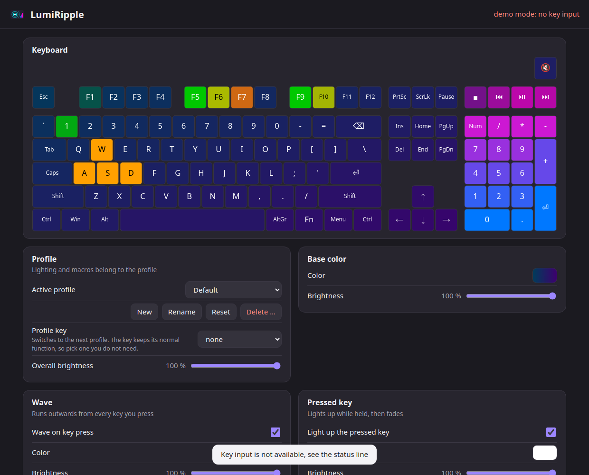

# LumiRipple

Reactive lighting for keyboards with per-key RGB: waves that start at the key you press, live PC stats, a sound and microphone
display, highlighted keys, gradients, profiles and macros. One settings page in the browser, the same on Linux, Windows and macOS.

LumiRipple does not talk to the keyboard itself. It uses the [OpenRGB](https://openrgb.org) SDK server, or
[OpenLinkHub](https://github.com/jurkovic-nikola/OpenLinkHub) for Corsair boards on Linux, so it works with keyboards those
projects support with named per-key LEDs. It is an independent project and not affiliated with either of them.



## Install

**Linux** (Debian, Ubuntu, Fedora, Arch, openSUSE, Alpine, others with Python 3.10+) **and macOS**

```sh
curl -fsSL https://raw.githubusercontent.com/OWNER/lumiripple/main/install.sh | bash
```

**Windows 10/11** (PowerShell, needs Python 3.10+)

```powershell
irm https://raw.githubusercontent.com/OWNER/lumiripple/main/install.ps1 | iex
```

Prefer to read before you run? Please do: [install.sh](install.sh), [install.ps1](install.ps1). Both also work from a checkout.
Uninstalling is described in [docs/INSTALL.md](docs/INSTALL.md).

Then:

1. Start the OpenRGB SDK server (OpenRGB: tab *SDK Server* > *Start*, or `openrgb --server --server-host 127.0.0.1`).
   Corsair with OpenLinkHub: set `"enableOpenRGBTargetServer": true` in its `config.json` and restart it.
2. Run `lumiripple open`.

No keyboard at hand? `python3 -m lumiripple run --demo` in a checkout, then `python3 -m lumiripple open` in a second terminal.

## What it can do

| Feature | Settings |
|---|---|
| Wave from the pressed key | color or gradient, brightness, speed, width, fade |
| Pressed key lights up | color or gradient, brightness, fade out, over or under displays |
| Base color | color or gradient in four directions, still or moving |
| Highlighted keys | any keys, own color and own wave color |
| PC stats | CPU, GPU, RAM, GPU memory, temperatures on any neighbouring keys |
| Sound and microphone | 16 bands on the number pad, letters, number row, F keys, navigation, main block or everything |
| Other lights | logo, light bars and special keys one by one |
| Profiles | as many as you like, switch by key |
| Macros | record and replay with exact timing, speed, finish now, cancel |
| Short touches | ignore presses below a minimum time (lighting only) |

All settings are explained in [docs/SETTINGS.md](docs/SETTINGS.md).

## What has been tested

Being honest about this matters more than a long list.

| What | State |
|---|---|
| Linux, Corsair K70 RGB PRO through OpenLinkHub | tested on hardware: frames, key input, macro device |
| Linux through OpenRGB | protocol read against a real server; no keyboard was connected to it |
| Installer on Debian 12, Ubuntu 24.04, Fedora, Arch, openSUSE Tumbleweed, Alpine | run in containers without systemd, demo mode |
| systemd service and helper from the installer | the same sandbox settings were tested on hardware, the installer step itself not yet |
| Windows, macOS | **untested**. The code and installers exist, only unit tests (CI) and a syntax check cover them |

Reports for other keyboards and systems are very welcome, see [CONTRIBUTING.md](CONTRIBUTING.md).

## Please know before you install

A program that reacts to key presses has to read them. LumiRipple never stores them, except while you record a macro. On Linux
the part that reads keys runs in its own sandboxed service without internet access. Details: [docs/SECURITY.md](docs/SECURITY.md).

## More

[How it works](docs/HOW-IT-WORKS.md) · [Why it is built this way](docs/DESIGN.md) · [Troubleshooting](docs/TROUBLESHOOTING.md) ·
[Changes](CHANGELOG.md) · [License (MIT)](LICENSE)

Most of the code was written with the help of an AI assistant (Claude).
